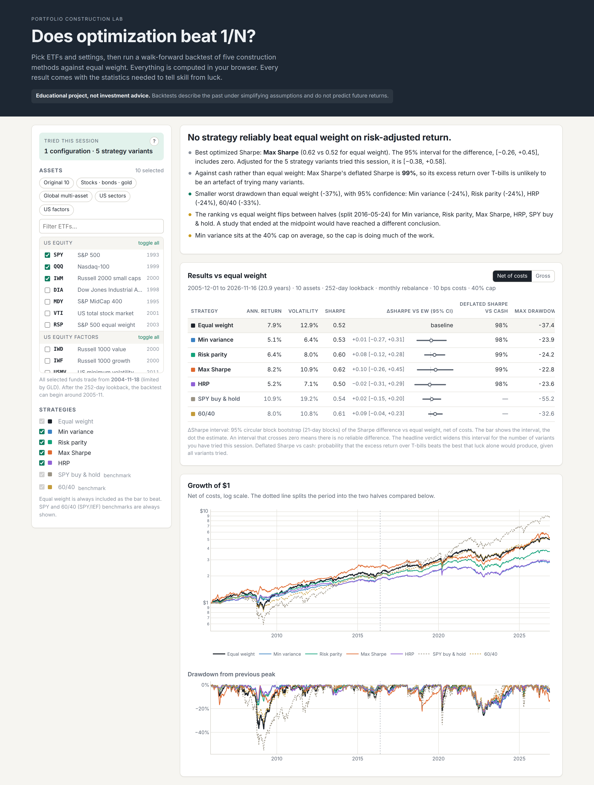
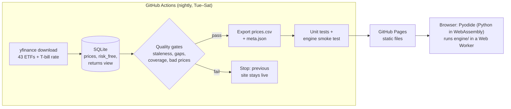

# Does optimization beat 1/N?

**[Live site →](https://USERNAME.github.io/REPO/)** · An interactive walk-forward backtest of portfolio construction methods on a curated menu of 43 ETFs. It runs entirely in your browser, and the statistics are built to tell skill from luck.



> Educational project, not investment advice. Backtests describe the past under simplifying assumptions and do not predict future returns.

## The question

Do optimized portfolios (minimum variance, risk parity, max Sharpe, hierarchical risk parity) beat simply holding every asset in equal weight once you measure out of sample, pay trading costs, and account for estimation error?

On the original 10-ETF universe over 2005–2026, **no method reliably beat equal weight on risk-adjusted return**. Every Sharpe difference has a 95% interval that includes zero. The risk-based methods did deliver a **statistically significant reduction in drawdowns** (about −24% against −37%). The ranking also flips between the two halves of the sample. Full write-up: [research/results/SUMMARY.md](research/results/SUMMARY.md).

The site lets anyone test that conclusion on other ETF combinations, settings and periods. It's designed so that searching until something looks good doesn't produce a misleading answer.

## Built-in safeguards against overfitting

A page full of toggles invites data snooping, so the page pushes back:

| Safeguard | What it does |
|---|---|
| **Confidence intervals vs equal weight** | Every Sharpe difference comes with a 95% circular block-bootstrap interval (21-day blocks, both series resampled together), drawn as a bar next to the number. |
| **Trial counter + multiple-testing adjustment** | Each run in the session is counted. The headline verdict widens its interval for the number of strategy variants tried (Bonferroni), and a deflated Sharpe ratio (Bailey & López de Prado, 2014) does the same for the comparison with cash. |
| **Automatic split-period check** | Results are shown for the first and second halves of the period, and the verdict flags any strategy whose ranking flips. |
| **Benchmarks that can't be switched off** | Equal weight, SPY and 60/40 are always included. |
| **Weights over time, shown by default** | A "winning" strategy that's really 40% in one bond fund the whole time is visible at a glance. |
| **Drawdown and same-risk comparisons** | A bootstrap interval on the max-drawdown difference, plus every strategy scaled to equal weight's volatility. |
| **Cost sensitivity** | Sharpe at 0, 5, 10 and 25 bps, so you can see whether an edge survives realistic costs. |

## How it works



- **No server and no tokens.** Pages serves static files, and the same Python engine used in research and tests runs in the visitor's browser via [Pyodide](https://pyodide.org). A typical run takes about 15–20 seconds. The first visit downloads about 30 MB of Python runtime, which the browser then caches.
- **Walk-forward.** On each rebalance date a strategy sees only the trailing lookback window. Weights apply from the next trading day and drift with prices between rebalances. Costs are bps × turnover.
- **Covariance.** Ledoit-Wolf shrinkage, reimplemented in numpy (tested against scikit-learn) so the browser doesn't need to download sklearn.
- **Max Sharpe** uses raw trailing mean returns on purpose, to show estimation error. It's solved with an exact convex reformulation, about 200× faster than a frontier sweep, which is what makes in-browser runs practical.

## Repository layout

| Path | Contents |
|---|---|
| `engine/` | Pure computation: strategies, simulation, statistics, and `api.run_all` (config in, JSON out). No I/O, so it runs in CPython and in Pyodide. |
| `pipeline/` | `universe.py` (curated ETF menu), `refresh.py` (download → SQLite → quality gates → export), `build_site.py`, `smoke_test.py` |
| `site/` | Static front end: `index.html`, `style.css`, `app.js` (UI, URL state, trial counter, charts), `worker.js` (Pyodide) |
| `research/` | The original 10-ETF case study (`case_study.py`) and its results |
| `tests/` | Synthetic-data tests: manual share-count check, no-look-ahead, weight constraints, risk parity, deflated Sharpe, config validation, pipeline quality gates |
| `.github/workflows/` | `deploy.yml` (nightly refresh and deploy), `tests.yml` (PRs and branches) |

## Run locally

```bash
python3 -m venv .venv && .venv/bin/pip install -r requirements.txt
```

```bash
.venv/bin/python -m pytest
```

```bash
.venv/bin/python -m pipeline.refresh && .venv/bin/python -m pipeline.build_site
```

```bash
.venv/bin/python -m http.server 8765 --directory _site
```

Then open http://localhost:8765. To rerun the case study on the latest data:

```bash
.venv/bin/python -m research.case_study
```

## Deploy your own copy

1. Push this repository to GitHub.
2. In **Settings → Pages**, set **Source** to **GitHub Actions**.
3. Run the **Refresh data and deploy site** workflow once from the Actions tab (it also runs on every push to `main` and nightly).
4. Replace `USERNAME/REPO` in the link at the top of this README.

## Data notes

- Prices are adjusted closes (dividends and splits) from Yahoo Finance via `yfinance`. The risk-free rate is the 13-week T-bill yield (`^IRX`).
- A nightly refresh is published only if every hard quality check passes. Large daily moves (beyond ±15%) are kept, not dropped, and listed in `data/meta.json` for review.
- Free data sources revise history. Each published `meta.json` records the download time and library version.
- Check Yahoo Finance's terms of use before redistributing price data. The site publishes a derived price file (`data/prices.csv`).

## Limitations

- A flat bps cost model ignores market impact and bid-ask spreads that widen in stress periods.
- The same-risk comparison uses full-sample volatility, so it's a comparison aid, not a tradable strategy.
- The multiple-testing adjustment counts only variants tried in the current browser tab. It can't know about searching done elsewhere.
- ETFs only. Individual stocks would need point-in-time index membership and delisting returns (see [the original plan](portfolio_construction_project.md), section 9).
